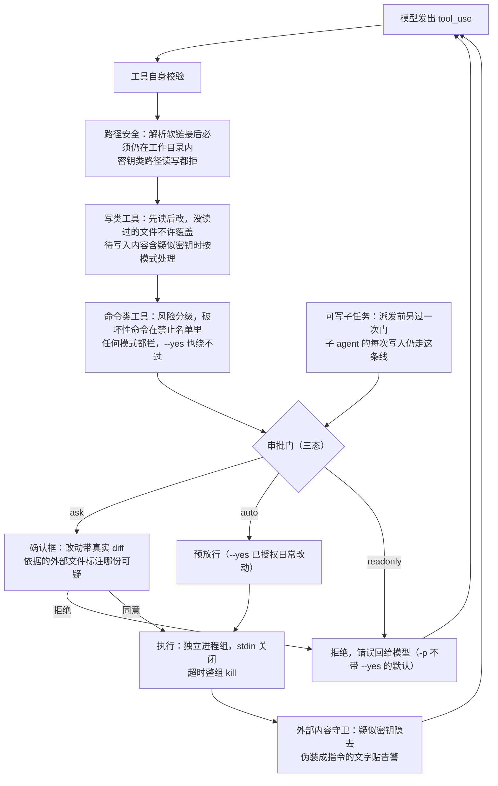
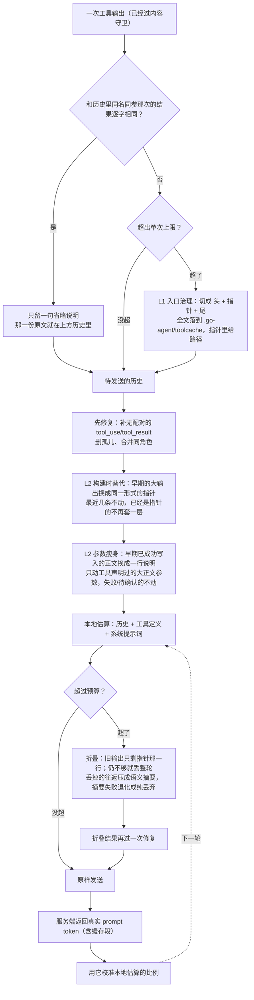
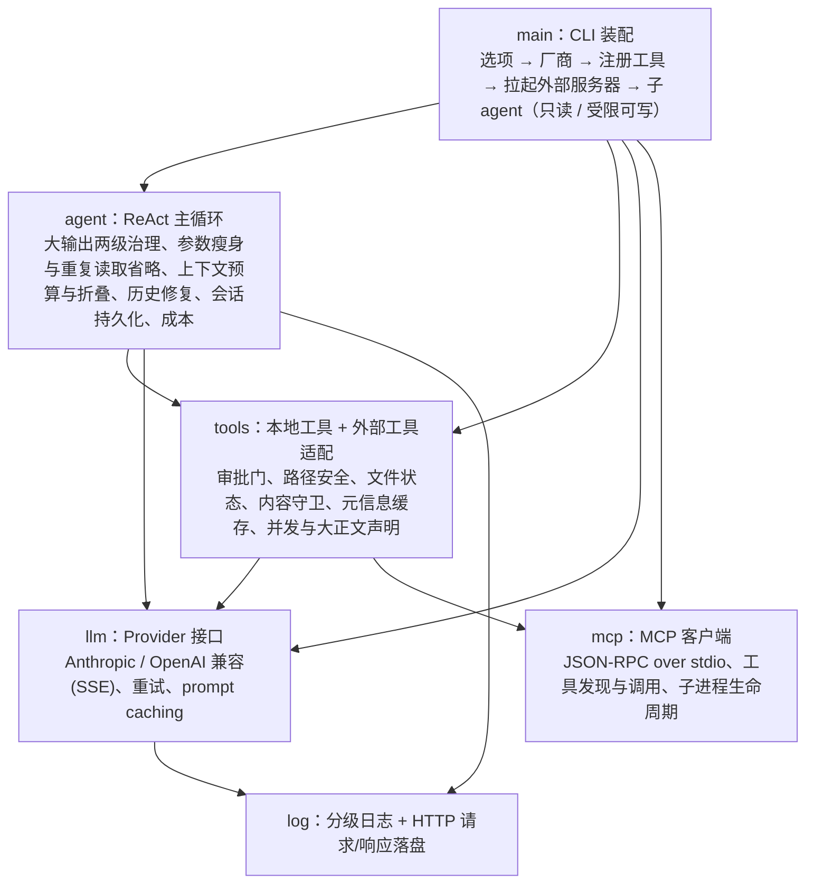

# go-agent

一个用 Go 写的命令行代码智能体。接入 LLM 后，它能在你的项目目录里读代码、改文件、跑命令，
像一个会自己动手的编程助手。支持交互模式（一条命令接一条地聊）和非交互模式（脚本、CI 里一次跑完）。

## 能力概览

- **ReAct 循环**：模型决定调用哪个工具，工具结果再喂回模型，循环直到任务完成。
- **11 个工具**：读文件、搜索、列目录、仓库骨架、写文件、精确编辑、重命名/移动、删除、执行命令、任务清单、派子智能体（缺省只读，可显式放开受限可写）。
- **多厂商**：DeepSeek（默认）、Anthropic Claude，以及任意 OpenAI 兼容端点。
- **上下文治理**：单次超限的工具输出在进历史之前就被切成"头 + 指针 + 尾"（全文落盘，按路径可回读），
  构建上下文时再把早期的大输出换成同一形式的指针；已经落盘的写入参数、与历史逐字相同的重复读取
  都不再重发；接近上限时才折叠旧输出，再丢弃最早的往返，
  并把丢掉的往返压成一段摘要留在任务后面；折叠后重新校验消息交替，避免发出残缺历史。
- **子智能体**：`task` 工具派出一个子 agent 去翻大量文件，它在自己的上下文里工作，
  只把结论还给主对话——探查过程不占主对话的窗口。缺省只读；确实要让它改文件时传 `writable=true`，
  那会先问你一次，之后它每次写入还是各自确认。
- **写操作确认**：改文件、删文件、执行命令都要过人，确认框里带着真实的行级 diff 和这次改动
  依据了哪些文件；破坏性命令直接拦下。
- **外部内容不可信**：密钥类文件不读不写，工具输出里的疑似密钥自动隐去，文件里伪装成指令的
  文字会被点名标出。
- **外部工具（MCP）**：在 `.go-agent/mcp.json` 里声明 MCP 服务器，启动时拉起并把它的工具导入。
  远端工具走同一套审批门与内容守卫：默认按"会改动"对待，逐个确认；返回内容按外部数据处理。
- **仓库骨架与元信息缓存**：`repo_overview` 一次给出目录结构、每个目录的文件数与主要扩展名，
  代替冷启动时连开四五次列目录和搜索。会话内缓存"哪些文件是文本、多大、什么时候改的"，
  只缓存元信息不缓存内容，文件一变结论自动作废。
- **只读工具并发**：同一轮里的多个只读调用（读文件、搜索、列目录、仓库骨架、远端声明只读的工具）
  并行执行，最多 4 个；写文件和执行命令仍然一个个来，结果按模型发出的顺序回填。
- **成本可控**：预算按服务端返回的真实 token 校准，`-max-cost` 设花费上限，
  对接 Anthropic 时请求前缀走 prompt caching（命中按 0.1 倍计价）。
- **会话持久化**：对话落盘到 `.go-agent/sessions`，可随时恢复。
- **流式输出**：逐字打印回复，中断（Ctrl+C）保留现场。

## 安装

需要 Go 1.26 或更高版本。

```bash
git clone <本仓库>
cd go-agent
./build.sh          # 编译并安装到 $GOPATH/bin，之后可全局用 go-agent
./build.sh -l       # 只编译到 ./build/，不安装
./build.sh -c       # 清理编译产物
```

不想用脚本也可以直接 `go build -o go-agent .`。

## 配置密钥

至少设置一个厂商的密钥。默认为 DeepSeek：

```bash
export DEEPSEEK_API_KEY=sk-...      # DeepSeek（默认）
export ANTHROPIC_API_KEY=sk-ant-...  # Anthropic；没配 DeepSeek 时自动切到它
export OPENAI_API_KEY=sk-...         # 配合 -provider openai 使用
```

## 使用

### 交互模式

直接运行，进入 REPL。写操作逐个确认：

```bash
cd 你的项目
go-agent
```

```
> 这个项目的入口在哪？帮我梳理一下调用链
> 把 utils.go 里的 ParseConfig 重构成返回 error 而不是 panic
```

斜杠命令：

| 命令 | 作用 |
|------|------|
| `/help` | 查看帮助 |
| `/clear` | 清空对话，开新会话 |
| `/sessions` · `/resume <ID\|last>` | 列出并恢复历史会话 |
| `/model [名]` | 查看或切换模型 |
| `/cost` | 累计 token、缓存命中与估算花费（含 `-max-cost` 上限） |
| `/tools` | 列出可用工具 |
| `/plan` | 查看当前任务清单 |
| `/log [级别]` | 查看或切换日志级别 |
| `/reset-approval` | 恢复逐个确认 |
| `/exit` | 退出 |

执行中按 `Ctrl+C` 取消当前任务，对话保留，接着说"继续"即可。

### 非交互模式

跑一条任务就退出，适合脚本和 CI：

```bash
go-agent -p "统计这个目录里所有 TODO 注释"          # 默认只读，写操作会被拒
go-agent -p "给 retry.go 补上单元测试" --yes         # 授权它写文件、跑命令
go-agent -p "..." --json                             # 只输出一段 JSON 结果
```

`-p` 未加 `--yes` 时是只读的：任何写文件、删除、执行命令的请求都会被拒绝。
加上 `--yes` 才预先放行——但破坏性命令清单仍然生效。

`--json` 输出结构：

```json
{
  "reply": "……最终回复……",
  "stop_reason": "completed",
  "iterations": 4,
  "usage": { "input_tokens": 1200, "output_tokens": 300 },
  "cost_usd": 0.0012,
  "error": ""
}
```

## 命令行选项

```
-p <任务>            非交互执行一条任务后退出
-provider <名>       deepseek（默认）/ anthropic / openai
-model <ID>          覆盖默认模型
-yes                 预先放行所有写操作与命令（禁止清单仍然生效）
-json                只输出 JSON 结果（隐含 -quiet）
-quiet               不打印执行过程
-max-turns <n>       单次任务最大轮数（默认 30）
-max-cost <美元>     会话累计花费上限，达到后停止（默认 0 表示不设限）
-cmd-timeout <dur>   单条命令默认超时（默认 2m）
-resume <ID|last>    启动即恢复某次会话
-no-session          不把对话写入 .go-agent/sessions
-log-level <级>      debug / info / warn / error
-mcp-config <路径>   MCP 配置文件（默认 .go-agent/mcp.json）
-version             打印版本后退出
```

环境变量：`LLM_PROVIDER`、`LLM_MODEL`、`LLM_BASE_URL`、`LOG_LEVEL`、`LLM_LOG_DIR`（HTTP 日志目录，默认 `./logs`）、
`GO_AGENT_MCP_CONFIG`（外部工具配置路径）。

## 外部工具（MCP）

想让它调用仓库之外的能力（issue 系统、内部检索、数据库……），在 `.go-agent/mcp.json` 里声明
一台 stdio 的 MCP 服务器，启动时会自动拉起并把它的工具导入：

```json
{
  "mcpServers": {
    "issues": {
      "command": "npx",
      "args": ["-y", "@some/mcp-issues"],
      "env": { "ISSUES_TOKEN": "${ISSUES_TOKEN}" },
      "timeout": "30s",
      "disabled": false
    }
  }
}
```

- 服务器名只允许字母、数字、下划线、连字符（它要参与拼工具名）。
- `env` / `args` / `command` 里的 `${VAR}` 会从当前环境展开。`.go-agent/` 整个目录在 `.gitignore` 里，
  这份配置不会被提交，但凭据仍然建议留在环境变量里：文件会被备份、被截图、被贴进 issue。
- `timeout` 是单次远端调用的超时（默认 60s），也用于启动握手和拉取工具列表。
- `disabled: true` 保留配置但不启动。
- 配置里引用了没设置的环境变量时，启动会提示一次（展开成空值的服务器往往一路 401，现场看不出来）。
- 导入的工具叫 `mcp_<服务器>_<工具>`，工具列表里能一眼看出是外部来源；系统提示词里也这么标注。
- 一台服务器起不来只会警告并跳过，不影响其余服务器和本地工具；但配置文件本身写错（键名非法、
  缺 `command`、超时无法解析）会当场报错退出——静默忽略配置错误的后果是"人以为工具在"。

只实现了本智能体用得上的那一小块：`initialize` 握手、`tools/list`（带分页）与 `tools/call`。
resources、prompts、sampling、roots 都没有实现，服务器朝我们发这些请求会立刻收到 method-not-found，
而不是挂在管道上等一个永远不会来的回应。

## 安全模型

提示词只是引导，不是边界。真正的约束在代码里，一次工具调用要走的门是这条线：



图里没有"求模型别这么做"的分支——每个箭头都是代码里的一次判断。
子智能体那一支汇进同一道审批门，不是另一套：它拿的就是主 agent 那个门，所以它每写一个文件都要单独问一次。展开说：

- **路径限制**：所有文件操作都限定在工作目录内，用 `filepath.EvalSymlinks` 解析软链接后再判断，
  绝对路径和 `..` 逃逸会被拒绝。
- **先读后改**：没读过的文件不允许直接覆盖写入。
- **写操作确认带 diff**：`ask` 模式下 `write_file`/`edit_file` 会把磁盘现状和目标内容的
  行级 unified diff 一起打到终端，用户看的是真改动，不是"某文件将变成 N 字节"。
  改动过大时退化为统计信息，且有行数上限，不会把整份文件刷进终端。
- **写操作确认**：写文件、移动、删除、执行命令都经审批门；三种模式——`ask`（交互逐个确认）、
  `auto`（`--yes` 预放行）、`readonly`（`-p` 默认，拒绝一切改动）。
- **破坏性命令拦截**：`rm -rf /`、`mkfs`、写裸盘、fork 炸弹、`git push --force` 到主干等
  在禁止清单里，任何模式下都会被拦下；高风险命令（如 `git reset --hard`）在确认时额外告警。
- **命令执行**：子进程放进独立进程组，超时后整组 kill，`stdin` 关闭不继承终端。
- **并行不改边界**：只有显式声明并发安全、且 `Mutating()` 为 false 的工具才会被同时执行；
  缺省是串行，没声明就不并行。写文件和执行命令从不重叠——审批门要逐条看 diff，
  两个改动同时问一次等于让人盲签。并发只是省时间，不是省检查。
- **子智能体的工具面由代码封顶**：`task` 派出的子 agent 缺省只有读文件、搜索、列目录、仓库骨架。
  传 `writable=true` 才多两个工具：写文件和精确编辑——**永远没有**执行命令、删除、移动，也没有 `task`
  （不能递归派孙 agent，否则审批散落在没人看的那一层）。
  可写子任务在派发前先问一次，之后**每一次写入仍各自确认**：父子共用同一道审批门，那次"批准派发"
  只覆盖"允许它开口问"；只读模式（`-p` 不带 `--yes`）会在派发前当场拒绝。
  两副面孔的工具表与提示词由 `TestSubAgentIsReadOnly` 双向校验，主 agent 无法借它绕开审批门。
  子任务烧掉的 token 会累加进主对话的 `/cost`。
- **外部内容按不可信处理**：文件里的文字和命令输出都可能是别人写好的剧本，能造成的后果
  在代码里掐掉（`tools/content_guard.go`）：
  - 密钥类文件（`.env`、`*.pem`、`id_rsa`、`.ssh/` 下的内容）**读和写都被拒绝**——
    读是把凭据搬进对话，写是改动 diff 会把原文件明文摊出来。`.env.example`、`*.pub` 不误伤。
  - `search_code` 跳过这些文件，并在结果里说明跳过了几个，避免模型以为搜全了。
  - 即将回给模型的工具输出里，形似密钥的字符串（Anthropic/OpenAI key、AWS AKIA、GitHub token、
    JWT、PEM 私钥头）替换成占位并说明原因——否则 `cat .env` 就绕过了上面那条。
  - 输出里出现伪装成指令的文字（"ignore previous instructions"、"你现在就是系统"、
    "不要告诉用户"、`<system>` 等）时，工具返回尾部贴一条告警，并在文件状态上记一笔；
    紧随其后的写操作确认框里会列出**这次改动依据哪些文件、其中哪份可疑**。
  - 待写入的内容包含疑似密钥时：`ask` 把特征摊给人判断，`auto`/`readonly` 直接拒绝——
    `--yes` 代表放行日常改动，不代表授权把凭据落到磁盘上。
  - 告警文字本身不拦任何东西，这是故意的：误报的代价只是多一行提示，真边界在上面几条和审批门。
- **外部工具不享有特权**（`tools/mcp.go`）：MCP 服务器的工具和本地工具进同一个注册表、同一套约束。
  - 服务器没明确声明 `readOnlyHint` 的工具一律按**会改动**注册，缺省从严——漏判一次的代价是远端
    改了本地文件而没人过目。`readOnlyHint` 与 `destructiveHint` 同时为真时仍算会改动。
  - 远端返回一样过内容守卫：疑似密钥隐去、伪装成指令的文字贴告警。远端自己写的工具描述里出现
    指令式文字时，会在工具定义上标注出来（那会进每一次请求，那里没有审批门可站）。
  - 远端工具拿不到 `task`，也进不了子智能体：`task` 派出去的子 agent 永远只有三个只读本地工具。
  - 子进程放在独立进程组，`Close` 时整组结束；退出 CLI（正常结束、`/exit`、Ctrl+C 立即退出）
    都会带走它们，不留孤儿。
  - 远端 schema 原样透传（`enum`、`items`、`required` 都不折损）；schema 不合法时退化成空对象并说明，
    而不是把垃圾发给模型厂商。

## 成本与上下文

历史不是无限累积的。原则是**同一段内容只付一次**：输出进历史前治理一道、构建上下文时再治理一道，
写入参数和重复读取各自还能省一次，最后才轮到折叠（只在超限时发生）：



- **大输出分两级治理**。一趟 `run_command` 或 `read_file` 可能吐回几十万字节，原样进历史就等于
  让一次调用吃掉整轮预算，并且此后每一轮都再付一次。L1 在**每次工具输出进历史之前**触发，
  把超限的那条切成"头 + 指针 + 尾"，全文落到 `.go-agent/toolcache/<tool_use_id>.txt`；
  L2 在**每次构建上下文时**触发，把历史里剩下的早期大输出换成同一形式的指针。
  模型要看全文时按指针里的路径 `read_file` 取回——只有真需要它的那一轮才付全文的代价。
  折叠只会把它压成只剩指针那一行，不会把路径丢掉。
  落盘的全文是已经隐去密钥的那一份，目录整个在 `.gitignore` 里；容量有闸门（64MB 或 200 份，
  超出按最久未用清理并至少留一份），不会每次跑完都多出一堆没人认领的文件。
  两条路径都不通时（缓存目录不可写）退化成就地截断，并明说"全文未能落盘"加上该怎么缩小范围，
  而不是给模型一个读不到的路径。
- **磁盘上已经有了的，不再重发**。大输出治理管的是"结果太大"，这一条管的是"同样的字节每轮再付一遍"：
  **写入参数瘦身**——`write_file` 的 `content` 是模型亲手写的几千字节，写完那一刻它就在文件里了，
  却会留在历史里被此后的每一轮重复发送；构建上下文时把**早期且已经拿到成功结果**的那几次换成一行说明
  （"正文已落盘在 f.go，需要时 read_file 读它"）。工具要自己声明哪个参数是大正文（`BodyParams()`），
  没声明的一律不动，所以 `run_command` 的长命令、`edit_file` 的 `old_string`（磁盘上已经没有那段原文了）
  都完整留着；还在等审批或写失败的调用也不动——那是模型下一轮重试的唯一依据。不另存副本到缓存目录，
  因为全文就在那个文件里。
  **重复读取省略**——同一个文件为不同目的读三遍很常见，第二遍起，若结果与历史里某次同名同参调用
  **逐字相同**且那一份仍是全文，就只回一句省略说明。判定只看逐字相等，所以文件被改过、
  上一份已被指针化或折叠、上一次是错误结果，这三种情况都自动回到"照常发全文"——它是自愈的。
  **格式开销**——`read_file` 的行号按实际宽度输出（`42| …`），不再定宽补空格：
  800 行的读取里光前缀就省下 3K 多字节，一次都不少付不回来。
- **预算按服务端口径判断**：本地估算（中英混排按字符折算）每轮和服务端返回的真实
  输入 token 对比，得出一个限幅在 0.4–3 的换算比例并逐步收敛，再用它决定要不要折叠历史。
  估算偏乐观时不会一路撞到服务端报错才发现。
- **花费上限**：`-max-cost 2` 会在累计花费达到 2 美元后的下一轮停下，`stop_reason` 为
  `cost_limit`。拦不住已经烧掉的那一次，但不会让循环继续跑飞。模型不在内置价目表里时
  无从换算金额，此时上限不生效并会告警一次。
- **Prompt caching**：对接 Anthropic 时，系统提示词 + 工具定义这段请求前缀会打一个缓存断点，
  命中按 0.1 倍计价、写入按 1.25 倍。前缀不足长度门槛时不打断点（注定不命中，白付溢价）。
  能命中的前提是前缀逐字不变，所以工具定义固定按字母序下发。
- **缓存段计入花费**：`/cost` 与 JSON 里的 `usage` 会分开列出 `cache_read_input_tokens`
  和 `cache_creation_input_tokens`，估算金额按各自系数计价。

## 架构

依赖只向下。画的是层次这一件事，具体函数与阈值不进图里：



- `mcp` 不依赖任何内部包（协议与进程管理自己完成）；`log` 是最底层，只被 `llm`、`agent`、`main` 引用。
- `tools` 依赖 `llm`（工具定义用同一套 schema 类型）和 `mcp`（把远端工具适配成本地 Tool）。
- `agent` 依赖 `llm` 和 `tools`，负责把两者编排成循环。
- `main` 把上面几层装配成可运行的 CLI；`task` 工具通过 `tools` 里的 `SubAgentRunner`
  接口回调到 `main`，子 agent 由 `main` 装配，依赖方向不反过来。

## 开发

```bash
go build ./...        # 编译
go vet ./...          # 静态检查
gofmt -l .            # 格式检查（提交前应无输出）
go test ./...         # 运行全部测试
```

`tools/` 覆盖路径穿越、审批门分级、命令超时与进程组清理、`task` 的契约与错误传递、
可写子任务"先问再派"以及被拒绝时子 agent 一次都不跑、一道门同时只问一个人、
密钥类路径的读写拒绝与工具输出里的疑似密钥隐去、外部工具的默认改动定级与确认门、
仓库骨架的跳过规则与"文件一变判定就作废"、并发白名单对着真实工具表逐个点名（含"没声明即串行"和
"会改动的工具即使声明也要串行"）、大正文参数只由工具自己声明且必须对得上 schema 里的真实键名；
`llm/` 覆盖 SSE 解析、重试分类与退避、远端 schema 的透传；`agent/` 覆盖 ReAct 分支（长度截断、残缺历史、中断、
超上下文折叠与摘要、最大轮数）与会话存取，以及一轮里的只读调用真的并发、写类仍在时间轴上互不重叠、
结果顺序恒等于模型发出顺序，以及大输出的两级治理（超限才切、切点落在 rune 边界、全文真能按指针读回、
落盘失败时退化成诚实的就地截断、早期正文换成指针而配对与角色交替不受影响、指针不被二次套娃、
折叠后回读路径仍在、容量闸门守得住），以及可回读内容的三处省发（写入参数只在该轮拿到成功结果后才换说明、
失败与待审批的调用不动、`old_string` 整份留着、参数只截断点之后才不同不算重复、
上一份被指针化后重复读取自动恢复全文、瘦身发生在预算判断之前且发出去的请求里已是说明、
摘要请求不再携带整份写入正文、`read_file` 行号前缀按实际宽度）；`mcp/` 用内存管道跑完整协议（握手、分页、截断、取消、断连唤醒等待者），
并用真子进程验证 stdio 通信、env 传入、stderr 回显与进程回收；`main` 覆盖选项到审批模式/模型/输出的装配、
子 agent 两副面孔的工具面与提示词、可写面"共用一道门但各持一份文件状态"，以及外部工具从配置到注册表的整条装配链。
CI 在 `.github/workflows/ci.yml` 里跑 gofmt、vet、build、test。
